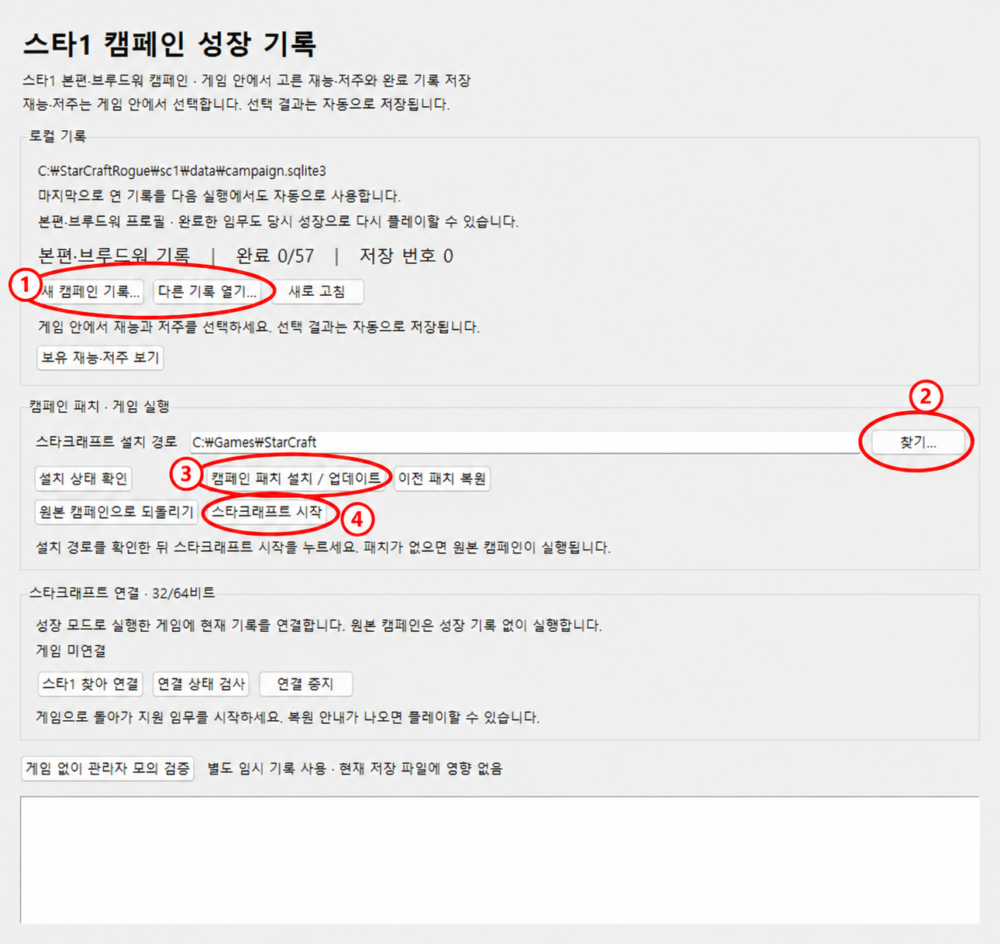
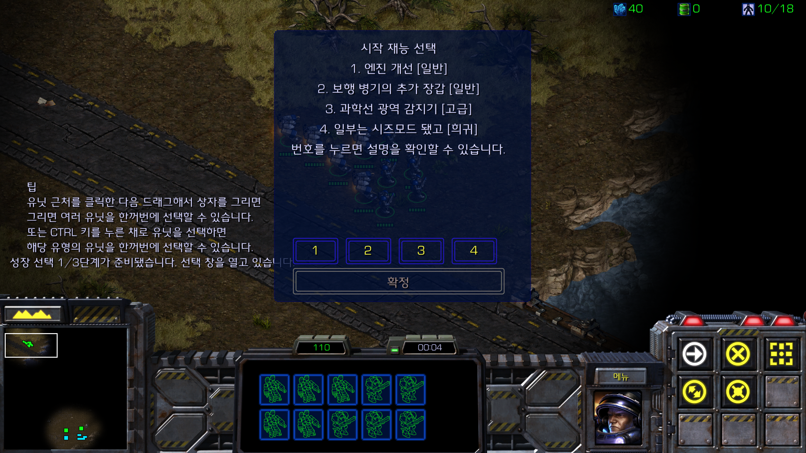
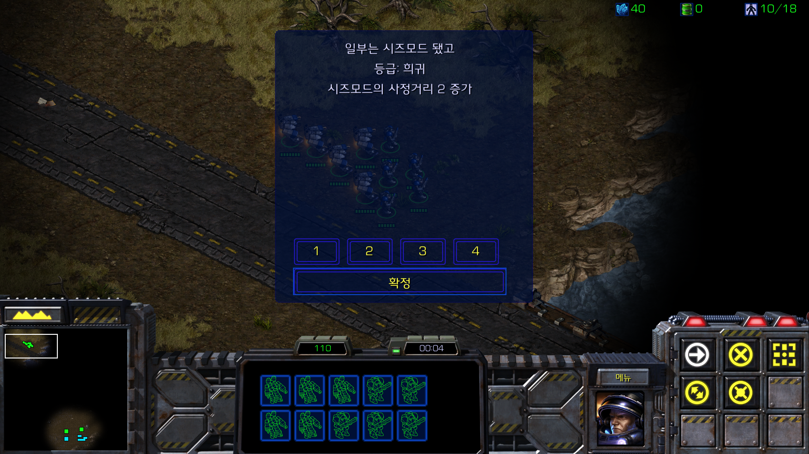
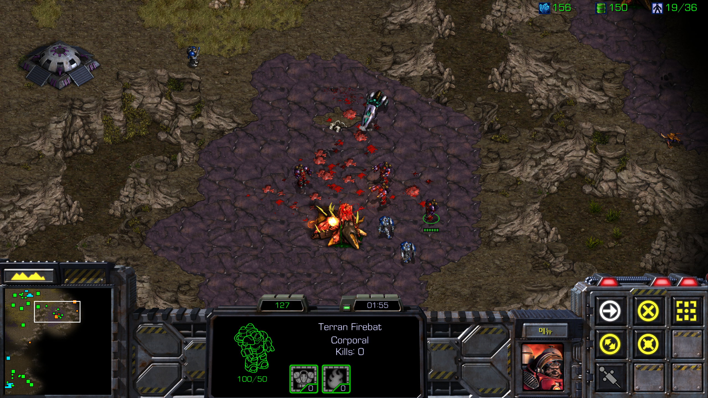

# 스타크래프트 캠페인 로그라이크

재능과 저주를 하나씩 쌓아가며 스타크래프트 캠페인을 다시 즐기는 모드예요. 오리지날과 부르드워 모두 지원하고, 원래 임무 목표에 추가 공세와 성장 요소를 더했어요.

## 다운로드

[정식 버전 1.0.6 받기](https://github.com/checheche12/sc1_roguelike/releases/download/v1.0.6/SC1_Roguelike_1.0.6.zip) · [릴리스 안내](https://github.com/checheche12/sc1_roguelike/releases/tag/v1.0.6)

Windows 64비트·스타크래프트 리마스터용입니다. ZIP 전체를 압축 해제한 뒤 `Start_Campaign.exe`를 실행하세요. Python은 따로 설치하지 않아도 됩니다.

## 설치하고 시작하기

실행 중인 스타크래프트를 종료하고, ZIP 전체를 원하는 폴더에 압축 해제해 주세요. 그다음 `Start_Campaign.exe`를 실행하면 아래 화면이 나와요.

**저주 개수도 조절할 수 있어요.** 실행기의 **난이도 · 임무당 저주 선택**에서 0~4회를 고른 뒤 게임을 시작해 주세요. 기본값은 3회이며, 재능은 그대로 임무당 3회를 받습니다. 자세한 적용 시점은 아래 [저주 난이도](#저주-난이도)에 정리했어요.

1. `새 캠페인 기록…`으로 기록을 만들거나, `다른 기록 열기…`로 기존 기록을 골라 주세요.

   1-1) 진행중인 기록을 사용할 경우에는 이미 재능을 받았던 미션에서는 추가로 받을 수 없어요.

2. `찾기…`를 눌러 스타크래프트 설치 폴더를 지정해 주세요.
3. `캠페인 패치 설치 / 업데이트`를 눌러 주세요.
4. `스타크래프트 시작`을 누르고, 싱글 플레이 캠페인에서 임무를 새로 시작하면 돼요.

실행기 옆에 있는 `runtime`과 `sc1` 폴더는 함께 보관해 주세요. 패치 파일은 게임 설치 폴더 안의 `SC1CampaignGrowth`에 들어가요.

## 저주 난이도

로더의 **난이도 · 임무당 저주 선택**에서 0~4회를 고를 수 있어요. **재능 선택은 기존 3회**를 유지하며, 기본값 3회는 기존 방식이에요. 0회는 새 저주를 고르지 않는 설정이에요.

| 임무당 저주 | 선택 시점 |
|---|---|
| 0회 | 없음 |
| 1회 | 시작 |
| 2회 | 시작·중간 |
| 3회 | 시작·중간·완료 직전 |
| 4회 | 시작·진행 전반부·중간·완료 직전 |

난이도는 아직 선택을 시작하지 않은 임무부터 적용해요. 진행 중인 임무의 선택과 이미 보유한 재능·저주는 유지해요. 연결 중에는 난이도 선택이 잠기므로 게임을 시작하기 전에 설정해 주세요. 캠페인 마지막 임무의 완료 직전 보상 생략은 기존과 같아요.

## 업데이트와 기록

새 버전은 새 폴더에 압축을 풀고 같은 방법으로 설치하면 돼요. 기존 기록을 이어가려면 관리자에서 이전 배포 폴더의 `sc1/data` 안에 있는 기록 파일을 열어 주세요. 기록이 잘 열리는 걸 확인할 때까지 이전 폴더는 남겨 두는 게 좋아요.

재능·저주 선택과 임무 완료 기록은 자동으로 저장돼요. 다만 임무 도중에 게임을 저장했다가 불러오는 방식은 아직 지원하지 않아요.

전체 63개 지도에 자동 검사를 적용했고, 실제 플레이와 밸런스는 계속 확인하고 있어요.

## 플레이 예시

인게임 화면 펼쳐 보기

2026년 10월 15일 개발 중 찍은 실제 플레이 화면이에요. 현재 버전은 UI와 수치가 일부 달라요.

재능 후보를 고르는 화면이에요.

번호를 누르면 선택할 재능의 설명을 볼 수 있어요.

병력을 모아 적 기지를 공략하는 모습이에요.

## 개발 자료

빌드 방법은 [DEVELOPMENT.md](DEVELOPMENT.md)에 정리해 뒀어요. 실행용 ZIP은 위 다운로드 링크에서, 개발에 필요한 소스와 고정 입력은 이 저장소에서 받을 수 있어요.

## Special Thanks

스타2 로그라이크에서 캠페인을 새롭게 즐기는 아이디어에 영감을 받았어요. 재미있는 경험을 만들어 주신 제작자분들께 감사드려요.

초기 EUD 시제품을 만들 때 도움을 받은 [EUD Python(eudplib)](https://github.com/armoha/eudplib)과 [euddraft](https://github.com/armoha/euddraft), 그리고 eudplib의 [원래 프로젝트](https://github.com/phu54321/eudplib)를 만들고 이어 오신 분들께도 감사드려요.

현재 버전의 네이티브 플러그인과 자료 처리에 쓰인 [SAMASE](https://github.com/neivv/samase_plugin), [Tatti3](https://github.com/neivv/tatti3), [CascLib](https://github.com/ladislav-zezula/CascLib), 그리고 Python·Tcl/Tk·OpenSSL·Pillow·PyMS를 비롯한 오픈소스 프로젝트의 개발자와 기여자분들께 감사드려요. 공개해 주신 도구와 자료 덕분에 이 모드를 만들 수 있었어요.

StarCraft와 게임 자산의 권리는 Blizzard Entertainment에 있어요. 외부 도구와 참조 코드의 출처는 [THIRD_PARTY.md](THIRD_PARTY.md)에서 확인할 수 있어요.
